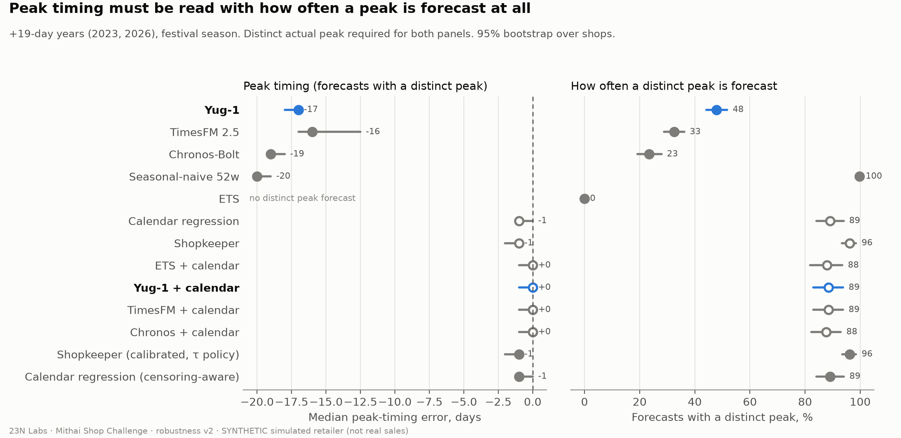
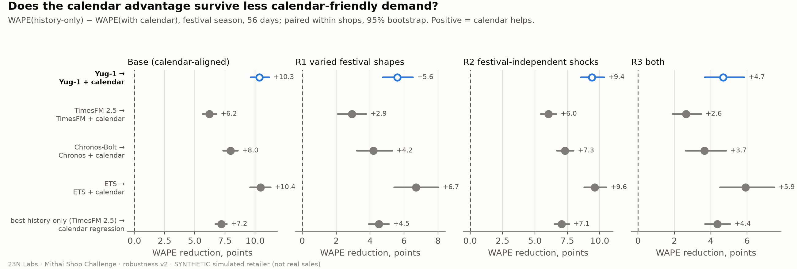
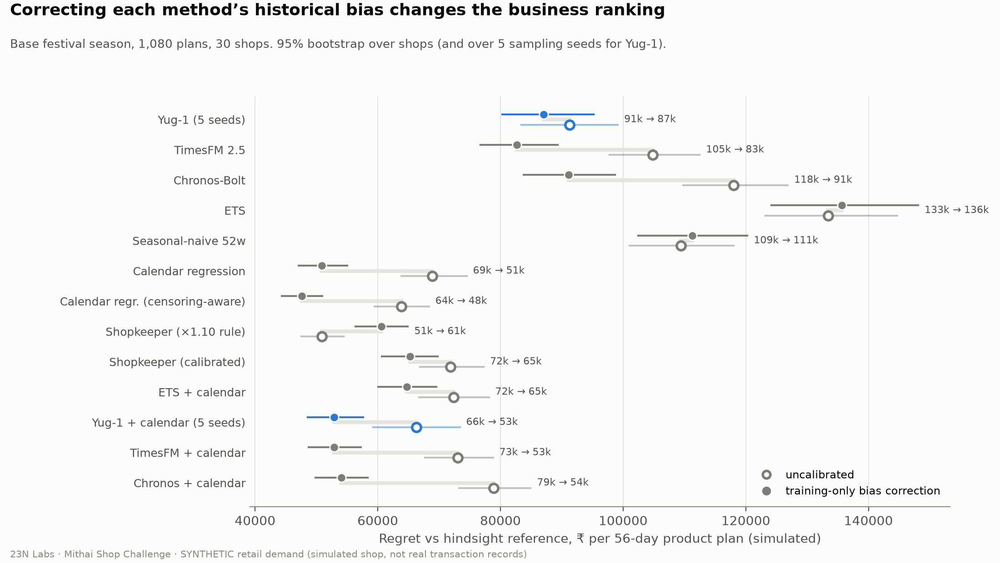
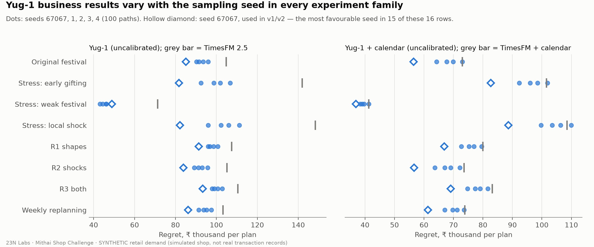

> **⚠️ Synthetic data notice.** This study uses a *simulated* Ahmedabad mithai shop. It does **not** use
> genuine shop transaction records. Every sales figure, rupee amount and "profit" in this article is a
> simulated outcome under stated assumptions. None of it is a saving achieved by, or promised to, any
> real retailer.

# The Diwali Trap

Diwali fell on **20 October 2025** and falls on **8 November 2026**, nineteen days later. A sweet shop that
plans kaju katli production from last October's sales will prepare for a rush that has not arrived yet.

We asked three questions about today's AI forecasting models, including **Yug-1** from Birla AI Labs:
- Do they fall into this trap?
- Does giving them the festival calendar help?
- Does a better forecast actually lead to a better production plan?

## How we tested it

We built a transparent simulator of a small mithai shop selling kaju katli, motichoor ladoo and gulab jamun
(in kg/day, 2019–2026). It includes:
- festival ramps that start weeks before Diwali;
- corporate gift-box orders booked in advance;
- wedding seasons and random bulk orders;
- sell-outs that hide how big demand really was, so past sales understate past demand.

Up to 30 independently randomised shops were simulated. In total we tested **13 forecasting strategies**:

| Group | Methods |
|---|---|
| Foundation models, history only | Birla AI Labs **Yug-1**, Google **TimesFM 2.5**, Amazon **Chronos-Bolt** |
| Statistical, history only | seasonal-naive, ETS |
| Calendar-aware regressions | standard, and a variant that accounts for sell-outs |
| Shopkeeper rules | a ×1.10 rule, and a calibrated version |
| Calendar correction | the same festival-calendar correction added to each foundation model and to ETS |

Every forecast was turned into a 56-day production plan under identical prices, costs, shelf lives and
capacity. We tested both a plan committed up front and weekly replanning with supplier lead times. We
measured regret: the simulated profit lost compared with a plan made with perfect hindsight.

Everything ran on free Kaggle GPUs and a laptop. That came to **241,920 forecasts**, with no forecasting
failures.

## Finding 1: history-only models lean toward last year's Diwali

In the years when Diwali moved 19 days later (2023 and 2026), models that see only past sales put extra
weight on last year's Diwali dates. Taking each model's overall bias into account, the extra weight was:

| Method | Extra weight on last year's dates |
|---|---|
| Seasonal-naive | +45% |
| **Yug-1** | **+29%** |
| Chronos-Bolt | +17% |
| TimesFM 2.5 | +15% |
| Flat ETS (the no-pattern baseline) | +10% |

When Yug-1 forecast a distinct peak, which it did in 48% of cases, the peak came a median of 17 days early.
TimesFM and Chronos-Bolt forecast distinct peaks less often (33% and 23%), and those peaks were also early.
The tendency that creates the trap also gives Yug-1 the strongest festival surge of any history-only model.

## Finding 2: giving models the festival calendar helps every one of them

A simple correction lets any model use the festival calendar. It learns, from past sales only, how demand
rises around each festival, then applies that pattern to the *known* future festival dates. This is an
add-on, not a built-in feature of any model. It reduced festival-season forecast error for every model:

- **Base simulator** (festivals follow the calendar): Yug-1 +10.3 points, TimesFM +6.2, Chronos-Bolt +8.0.
- **Hardest scenario** (festival shape varies every year, plus unrelated local shocks): +4.7, +2.6 and +3.7
  points. Smaller, but still positive.

## Finding 3: turning forecasts into decisions matters as much as the model

Every method under-forecast festival demand, because past sell-outs hide true demand. So we gave every
method the same training-only correction, learned only from each shop's own past forecasts and sales. That
reshuffled the business ranking. Regret per 56-day product plan, festival season:

| Method | Before correction | After |
|---|---|---|
| Calendar regression (accounts for sell-outs) | ₹63,812 | **₹47,602** |
| Calendar regression | ₹68,886 | ₹50,855 |
| TimesFM 2.5 + calendar | ₹73,043 | ₹52,847 |
| **Yug-1 + calendar** (average of 5 seeds) | ₹66,275 | ₹52,882 |
| Chronos-Bolt + calendar | ₹78,896 | ₹54,102 |
| **Yug-1** (history only, average of 5 seeds) | ₹91,265 | ₹87,051 |
| TimesFM 2.5 (history only) | ₹104,819 | ₹82,656 |
| Chronos-Bolt (history only) | ₹118,008 | ₹91,129 |

For scale, the perfect-hindsight plan earns about ₹327,000 per product plan in the simulation.

**What this tells us:**

- **Accounting for sell-outs was the most valuable single step.** After correction, the calendar regression
  that does so had the lowest regret in the base, varied-festival, shock, combined and weekly-replanning
  experiments. It did not win every stress test: with a weaker festival, Yug-1 + calendar and TimesFM 2.5
  were lower, and under a sudden local shock it tied Yug-1 + calendar.
- **After correction, the three AI models with the calendar cannot be separated.** Yug-1 + calendar versus
  TimesFM + calendar: ₹35 per plan, with a 95% interval of −₹1,914 to +₹1,603.
- **Before correction, history-only Yug-1 looked like the most profitable AI model.** That advantage came
  mostly from its forecasts being less biased low. After correction, TimesFM 2.5 was ahead by ₹4,395 per plan.
- **A simple "make 10% extra" shopkeeper rule** beat many uncalibrated models. Once forecasts were
  bias-corrected, it was overtaken by the calendar-informed methods.

## Finding 4: Yug-1's sampling seed matters

Yug-1 builds its uncertainty range from 100 random sample paths. Changing only the random seed moved the
share of days inside its 80% range during festivals between 68% and 80%. It also changed simulated
business results noticeably in every experiment. Point accuracy barely moved.

Our first analysis happened to use the seed that was most favourable for Yug-1 in 15 of 16 comparisons,
so this final version averages over five seeds.

## What it means

- **For shops:** give your forecasting tool the festival calendar, and correct for days you sold out. How
  you turn a forecast into a production quantity matters as much as which model you use.
- **For model builders:** native support for future-known calendar events, seasonality aligned to events
  rather than dates, and independent random draws per series would directly address what we observed.
- **For everyone:** this is a controlled simulation. Effects in real shops could be larger, smaller or
  different. Validation on real, consented retailer data is the essential next step.

## Limitations, in brief

- Synthetic data under our assumptions, with festival effects that remain roughly tied to the calendar.
- One planning-policy family, and no tuning for any method.
- Calibration uses censored past sales.
- Foundation models used zero-shot with default settings.

Several analyses were added after our first results, during subsequent review passes. The technical appendix labels
each result as pre-specified or post-hoc.

## Reproduce it

The code, synthetic-data generator, verified result summaries, inference notebooks and checksums are in this repository. The 367 MB raw synthetic forecast archives remain in the pinned private source; reproduce them using the instructions here. See the
[technical appendix](technical-appendix.md) and [README](README.md).

*23N Labs is independent. This study is not affiliated with or endorsed by Birla AI Labs, Google or Amazon.
We thank Birla AI Labs for publishing Yug-1 with clear versioning, which made this independent study
possible.*
